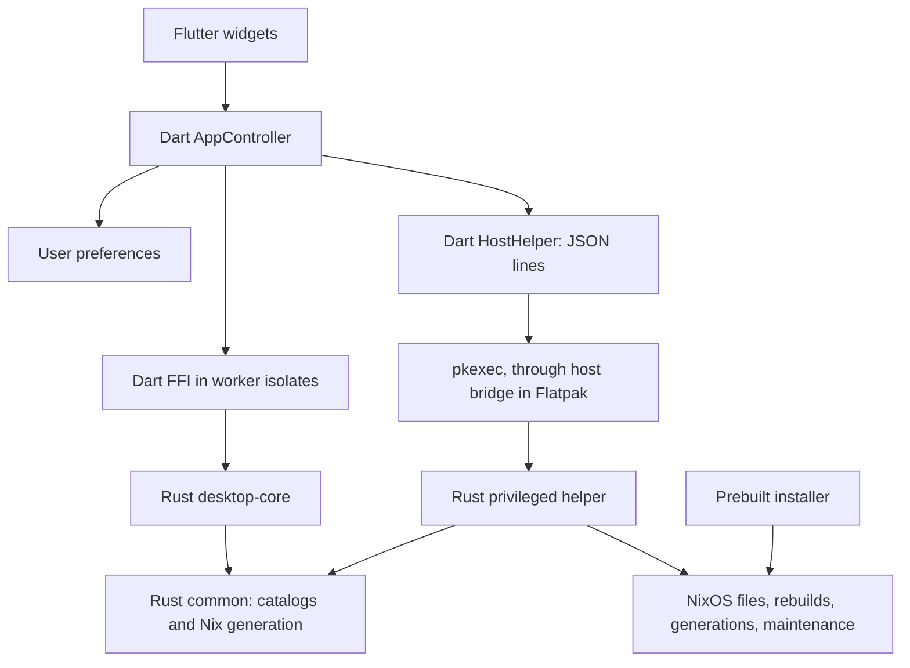

# Architecture

Flutter provides the Linux desktop UI. Rust owns configuration rules and Nix generation. A separate authenticated helper performs host operations. Native and Flatpak builds use the same frontend.

## UI and domain state

`desktop/lib/ui` owns layouts, themes, navigation, focus, and dialogs. `AppController` owns selections, form drafts, validation errors, progress, logs, and the saved-state baseline. Invalid drafts survive page changes and block Apply. Desktop selection can be toggled off. The change review compares the draft with saved Toolkit state, not the full host package inventory.

Dart uses `ConfigurationDto` to exchange the Rust `AppState` format. Bundle metadata, package mappings, validation, and generated Nix come from `crates/common`. `crates/desktop-core` exposes six operations: `bootstrap`, `probe_host`, `parse_packages`, `validate`, `preview`, and `profile_preview`.

The FFI boundary has two exports: `toolkit_call` and `toolkit_free`. Requests are bounded to 1 MiB; responses carry a result or typed error. Dart frees each Rust result exactly once and releases its own request buffer. Calls run in worker isolates, share no mutable core state, and need no generated bindings. Tests exercise the real library, concurrent calls, Unicode, limits, and ownership.

## Helper sessions and apply

The GUI stays unprivileged. `HostHelper` launches `pkexec <helper>` with fixed arguments; Flatpak uses `flatpak-spawn --host -- pkexec <helper>`. Standard streams are forwarded automatically. An explicit helper override must be absolute and executable. Host operations require NixOS and a matching helper.

Requests and responses are bounded JSON lines. `BeginSession` opens an interactive session; `Cancel` interrupts work through that authenticated input pipe. The helper supervises process groups, and disconnecting an interactive session cancels active work. Older batch clients remain supported.

A normal apply sends `Apply`, followed by `WriteState` after success. Dry Run sends only `Apply` with `DryBuild`. The helper snapshots managed files before writing and holds the mutation lock through state persistence. Failed applies and dry runs restore managed files. Errors preserve the UI draft; success clears it only if no newer draft exists. An unsuccessful initial state load blocks Apply until reload succeeds.

An apply recovery journal records managed files and previous running/next-boot systems. The helper checks that the host has not changed before activation. Interrupted applies expose **Restore previous system** and block further mutations until recovery finishes. Recovery restores configuration and system selections, not service data. Build saves selections without activation; Test activates without changing next boot or starting a rollback timer.

## Configuration change detection

The Flutter frontend requires `ReadStateSnapshot`, which returns saved state and a SHA-256 revision. Apply sends that revision as `expected_revision`; the helper checks it under the mutation lock before managed writes or recovery setup. Reload and successful state saving fetch a new snapshot.

The revision covers non-hidden `.nix` files and `flake.lock` files beneath `/etc/nixos`, managed `state/state.json`, symlink targets, and resolved running/selected system paths. File contents stay on the host. Reads are limited to 4096 files, 32 MiB, and 32 directory levels; unreadable tracked files fail closed. State is read between two revision checks.

This catches edits made after loading, including another Toolkit instance's changes. It does not cover earlier edits, imported directories outside the tree, changed channel inputs, user profiles, or Flatpak installs. Symlinked Nix files are read; symlinked directories are not traversed. Editors do not share the helper lock, so the guard is not a filesystem transaction. Legacy clients can omit the revision; the current frontend requires it.

## Generated configuration

Preview and apply use the same Rust generation rules. Bundles are generated from catalog selections, including defaults for older state without a package map. Old bundle templates do not add hidden extras. Profile templates and fallbacks share their preview/apply behavior.

The helper writes modules before the final `selected.nix` import. Cleanup preserves unrelated filenames and rejects symlink trees. On Git flakes, generated modules are also embedded in `selected.nix` so new files survive Git source filtering. The initial integration file must be tracked; the app does not stage user files. Selection markers allow reconstruction when saved JSON is missing, including package aliases.

Generation deletion protects the selected and actually running systems. Maintenance uses an exact command allowlist. The NixOS 25.05 compatibility module serializes D-Bus reload before other service reloads and preserves failure reporting.

## Installer boundary

`install.sh` downloads a signed installer package and runs its privileged integration program, then launches the GUI as the desktop user. [packaging/nix/install.py](packaging/nix/install.py) edits marked imports and its own module, builds the candidate system, verifies the expected app/helper and unchanged host state, then activates it.

The installer shares `/run/lock/nixos-toolkit.lock` with the helper. Its separate journal and private backups support failed/interrupted install recovery without overwriting later external edits. It leaves Toolkit selections imported on uninstall. Cache trust is scoped to package download; it does not change permanent Nix trust settings.

## Preferences and packaging

User preferences live at `$XDG_CONFIG_HOME/nixos-toolkit/preferences.json`, falling back to `~/.config`. Dart reads the legacy theme format and cosmic preference when needed. Serialized temporary-file/rename writes preserve theme and window geometry; corrupt JSON is retained before replacement. System selections stay in the helper-owned `state.json`.

Linux CMake bundles the Rust library, Flutter runtime, plugins, AOT code, and templates beside the executable. Nix builds the core separately and passes its store path to CMake. Flatpak adjusts ELF paths in a separate checksummed bundle and installs under `/app/lib/nixos-toolkit`. The former libcosmic UI remains available as `.#reference` for comparison.

See the [technical reference](docs/reference.md) for paths and source files, [BUILDING.md](BUILDING.md) for checks, and [platform coverage](PLATFORM_SUPPORT.md) for validation limits.
