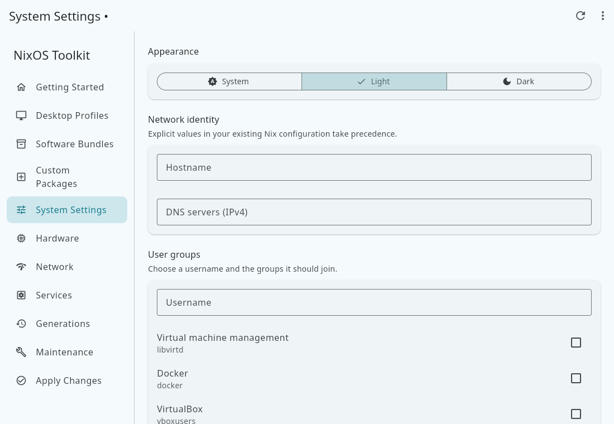
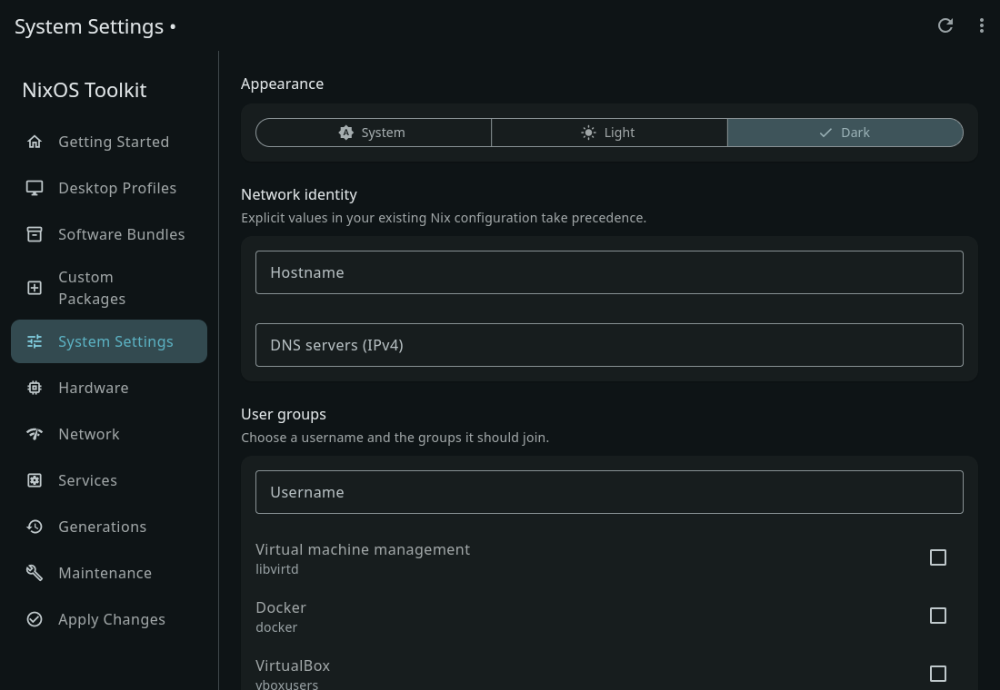

# NixOS Toolkit

NixOS Toolkit is a Linux desktop application for declarative NixOS management. The canonical frontend uses **Flutter/Dart**, with a shared **Rust core** and a separate privileged host helper. Linux and Linux Flatpak are the supported scope.

Choose from 13 desktop profiles, 16 software bundles, custom packages, hardware, network and 21 service settings. Review generated Nix locally, then apply through the host helper. Generations, maintenance and store usage also use that helper. On other Linux distributions, configuration and preview remain available; privileged actions explain their NixOS requirement.

The [software bundle catalog](docs/SOFTWARE_BUNDLES.md) documents Bazaar, AI tools,
language SDKs and container tools, with verified upstream links and installation
notes. Only tools with managed installation support appear in the catalog.




## Install on NixOS

The prebuilt x86_64 installer downloads signed Nix packages, installs the matching
helper and application-menu entry, and launches the app. Run it as your normal
user; it asks for sudo itself:

```sh
curl -fsSL https://github.com/goshitsarch-eng/Gosh-NixOS-Manager/releases/latest/download/install.sh | bash
```

See [INSTALLING.md](INSTALLING.md) for supported configurations, explicit flake
targets, updates, private backups, recovery and uninstall. The app is prebuilt;
NixOS still builds and activates the system integration. ARM64 needs separate
validation before prebuilt releases are offered.

## Develop

With stable Flutter, Rust and the Linux dependencies in [BUILDING.md](BUILDING.md):

```sh
cargo build --locked -p desktop-core
cd desktop
flutter pub get --enforce-lockfile
flutter run -d linux
```

The Flutter Linux build automatically builds and bundles the Rust library and Nix templates. Run the normal verification gate with `scripts/verify.sh`. Create a release archive with `scripts/package-linux.sh`.

In this cloud workspace, first run `. /workspace/setup/activate.sh`; the tools are installed without requiring system administrator access.

## Host integration

The UI stays unprivileged. Install `nixos-toolkit-helper` and its polkit policy through the NixOS module, then add the managed `selected.nix` import using the application's instructions. Existing Nix configuration remains under your control. Managed state retains its existing JSON format and path. Preferences retain the canonical XDG file and read the former cosmic theme setting when needed.

Getting Started explains how to use Toolkit alongside manual Nix configuration,
Home Manager and Flatpak/Bazaar. Keep manual settings in your own modules outside
`/etc/nixos/nixos-toolkit/`; that directory contains generated files. Prefer one
installation method per application and one place to manage each system setting.
Apply Changes shows additions, removals and changed settings before confirmation.
Its review describes Toolkit selections, not a complete software inventory.

```nix
programs.nixos-toolkit.enable = true;
```

`nix build .#gui` and `nix run` now select Flutter. `.#helper` remains the host helper; `.#reference` retains the former GUI for parity checks. The Flutter Nix package, core and helper build successfully. The app and helper have been exercised on a disposable NixOS 25.05 VM.

## Validation and release status

The [live NixOS VM report](docs/audit/LIVE_VM_QA.md) records real UI, rebuild, generation, maintenance, cancellation and recovery tests. The [initial audit](docs/audit/NIXOS_RELEASE_QA.md) covers the module matrix and earlier safety fixes. The current packages also have authenticated Flatpak host checks and a separate NixOS guest test for reboot, rollback and recovery.

Apply now checks the host configuration before activation and keeps a private recovery journal until the selection is saved. If an apply is interrupted, use **Restore previous system** before making further changes. This restores managed files and the previous running/boot configuration; service data is not rolled back. Install matching app and helper versions.

The current Flutter app also checks whether configuration changed since it loaded
the saved selections. A mismatch stops Apply before writing files. Use **Reload
saved selections** to discard an outdated draft after resolving manual edits.
Build saves proposed settings without activation; Test activates immediately
without changing the next boot and has no automatic rollback timer.

The NixOS module includes a NixOS 25.05 compatibility fix for the observed firewall/D-Bus activation timeout: it waits for the D-Bus reload job before submitting other reloads. Twenty-eight helper/CLI activations passed with the fix installed, including live port-rule checks; an intentionally failed firewall reload still failed the apply and recovered correctly. See [BUILDING.md](BUILDING.md) for standalone host integration. NixOS 25.05's insecure Electron check remains enabled; affected Gaming selections must be deselected or used on a channel with supported packages.

GitHub Actions cannot start because the repository owner's account is locked by a billing issue. The additional workflow checks are published through the connected GitHub app; see [BUILDING.md](BUILDING.md). Local checks do not replace successful release CI. Physical hardware, ARM64, screen readers and login to every desktop still need dedicated validation; see [PLATFORM_SUPPORT.md](PLATFORM_SUPPORT.md). Built native and Flatpak artifacts and checksums are under ignored `dist/`.

[ARCHITECTURE.md](ARCHITECTURE.md) explains state and bridge ownership. [MIGRATION_AUDIT.md](MIGRATION_AUDIT.md) accounts for the reference features, changes and remaining QA. Older implementation documents under `docs/audit` and `docs/migration` are historical; the old frontend remains a reference until host parity checks pass.

GPL-3.0-or-later. [Report an issue](https://github.com/goshitsarch-eng/Gosh-NixOS-Manager/issues).
